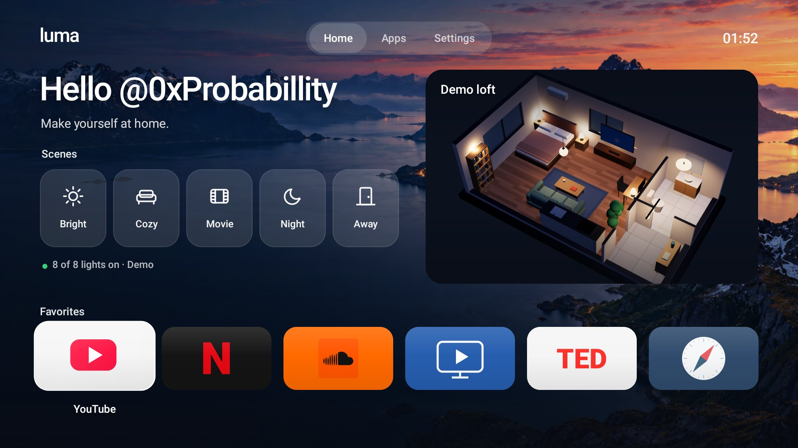
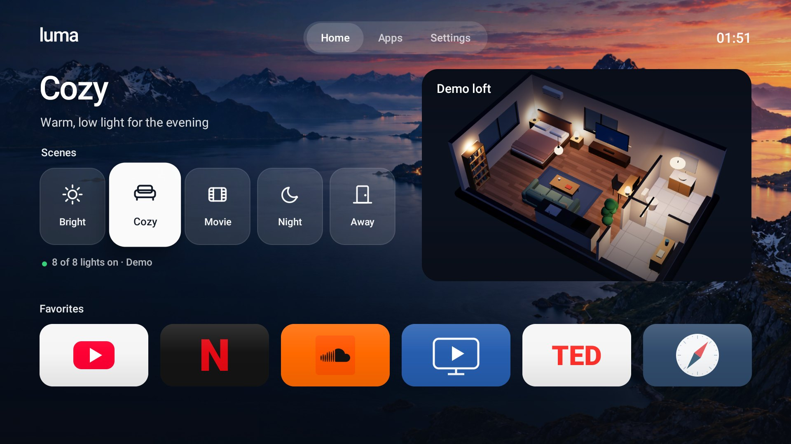
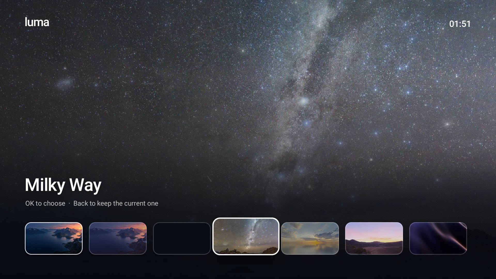
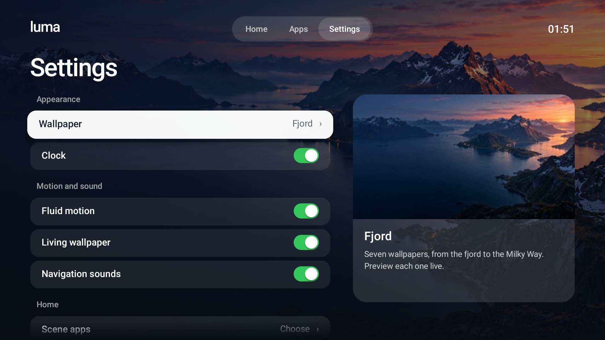
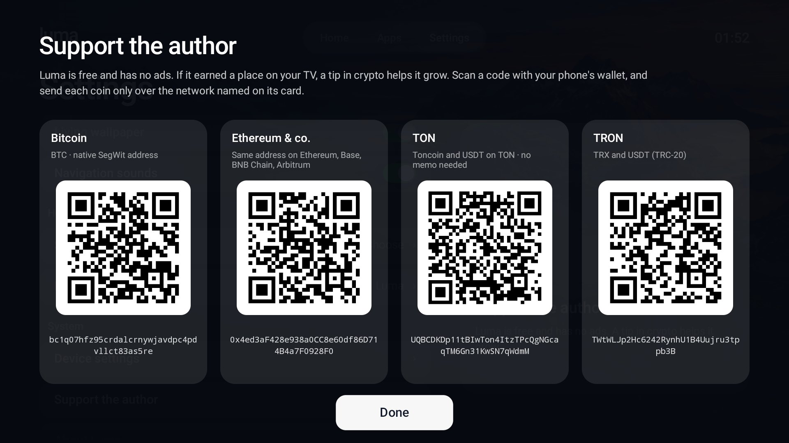
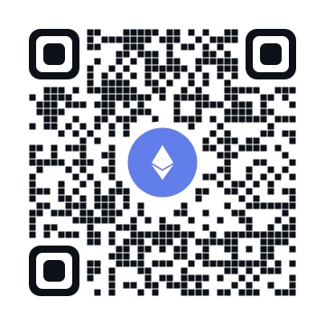
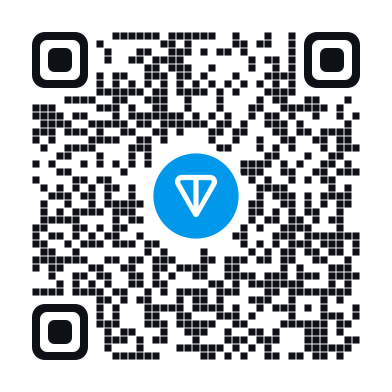

<p align="center">
  
</p>

<h1 align="center">Luma</h1>

<p align="center">
  A calm, tvOS-inspired home screen for Android TV and Google TV.<br>
  Your favourite apps over living wallpapers, with no ads, no sponsored rows and no tracking.
</p>

<p align="center">
  <a href="#install"><b>Install</b></a> &nbsp;·&nbsp;
  <a href="#make-luma-your-home-screen"><b>Make it your home screen</b></a> &nbsp;·&nbsp;
  <a href="#support-the-project"><b>Support the project</b></a>
</p>

<p align="center">
  Made by <a href="https://x.com/0xProbabillity">@0xProbabillity</a>
</p>

## What it does

Luma works on its own: it needs no smart home, account or other app. Everything below except the scene block
works on any Android TV.

- **A quiet Home.** A greeting with today's date, your favourite apps as large cards, and nothing you did not put
  there. Moving to an app shows its name and a line about it; hold OK on any app to show it on Home, move it or
  hide it.
- **Home widgets, page by page.** Above your apps, Home can show *Up Next* (the shows and videos you were
  watching, from the Continue watching list that YouTube, Netflix and other apps share with Android TV: OK
  resumes where you stopped), *Weather* (now, the next hours or the coming days), *Now Playing* (music playing on
  the TV, with play, pause and skip), *Inputs* (on a TV: its HDMI ports and live TV, named as in the TV's settings
  or after the device plugged in, OK switches to it and Home comes back) and *Control* (Wi-Fi, picture and sound,
  accessories, settings). Left and Right turn the pages; your apps stay underneath.
- **Every app, one tab away.** *Apps* lists everything installed on the TV, hidden apps included.
- **Light by day, dark at night.** The default wallpaper, *Silver*, is pale silver silk from sunrise to sunset and
  graphite silk after dark, and the whole interface turns light or dark with it. Sunrise and sunset are worked out
  for your TV's time zone, with no location permission and no network.
- **Living wallpapers.** Eight of them, from silver silk and a Norwegian fjord at dusk to the Milky Way. On the
  fjord, clouds drift and the water moves very slowly, with real depth: the sky and the mountains travel at
  different speeds as you move. Everything pauses while an app is open.
- **Feels like a TV, not a phone.** Springy focus, cards that tilt toward the direction you move, a pill that
  slides along the tab bar, and soft, quiet navigation sounds. *Fluid motion* and *Navigation sounds* turn off
  in Settings, and Android's own animation settings are respected.
- **Your smart home, if you have one.** The scene block appears only when
  [House Control TV](https://github.com/0xProbabillity/house-control-tv) is installed: Home then also shows five
  round scene buttons and a live 3D model of your home floating on the wallpaper, and a scene can open an app as
  the lights go down (*Movie* starts Netflix). Without it, Home is just your greeting and favourites over the wallpaper, and Luma picks House
  Control up as soon as you install it.
- **Easy to leave.** Settings → *Home screen* hands Home back to your TV's own launcher, and
  `./luma.sh restore` undoes everything the installer changed.

<p align="center">
  
  
  
  
</p>

## Requirements

| | You need |
| --- | --- |
| TV | Android TV or Google TV, Android 8.0 or newer, with **USB / network debugging** turned on (Settings → Device Preferences → About: press *Build* 7 times, then Developer options) |
| Computer | macOS or Linux with [ADB](https://developer.android.com/tools/releases/platform-tools) (`brew install --cask android-platform-tools`) |
| To build it | JDK 17, Android SDK build-tools 36.0.0 and platform `android-34`, Python 3. No Gradle |

## Install

Put the computer and the TV on the same network, then connect once (the TV asks you to allow it):

```bash
adb connect 192.168.1.50:5555   # your TV's address: Settings → Network
```

Download `luma-tv.apk` from [Releases](../../releases) and install it, or build and install it yourself:

```bash
git clone https://github.com/0xProbabillity/luma-tv.git && cd luma-tv
./luma.sh install
```

`./luma.sh build` only builds (`dist/luma-tv.apk`). With several devices connected, choose one:
`./luma.sh -s 192.168.1.50:5555 install`, or set `LUMA_DEVICE`. `./luma.sh status` shows the TV, the installed
version and which app opens at Home.

The build looks for the Android SDK in `$ANDROID_SDK_ROOT` (default: Homebrew's `android-commandlinetools`) and
for JDK 17 in `$LUMA_JDK`. It creates a signing key in `.signing/` the first time; keep it, or Android will refuse
to update Luma with a build signed by another key (`LUMA_KEYSTORE` chooses a different one). The APK in Releases is
signed with the project's release key, so switching between it and your own build means uninstalling first.

## Make Luma your home screen

```bash
./luma.sh home
```

Android lets the user choose a home app, but many TVs (Google TV, and the Android TV firmware
of many manufacturers) always put their own launcher first. `luma.sh home` makes Luma the default; when the TV still
prefers its launcher, it switches that launcher off (with `pm disable-user`, which keeps it installed with all
its data). It only ever touches the stock launchers it knows: Google TV's, the Android TV launcher, the
Leanback launcher, and Google TV's setup "recovery" screen, which would otherwise take Home over. It never
wakes a TV that is asleep.

To go back to your TV's own home screen:

```bash
./luma.sh restore
```

It switches back on exactly what `home` switched off (it remembers per TV, in `.local/`) and makes the original
launcher the default again. Luma stays installed; `adb uninstall dev.luma.tv` removes it. On a TV where the
launcher was never switched off, Settings → *Home screen* → *Return to the TV's home screen* does the same from
the couch.

## Make it yours

- **Greeting.** Home says "Hello". Settings → *Your name* makes it "Hello, Alex"; the name stays on the TV. To
  build a different default greeting: `LUMA_GREETING="Hi there" ./luma.sh install`, or put the line in
  `.local/greeting.txt` (ignored by git).
- **Favourites.** Hold OK on an app → *Show on Home*, *Move left* / *right*, *Move to first position* or *Hide from Home*. The first-run order is in `FIRST` in
  `MainActivity.java`.
- **Home widgets.** Settings → *Home widgets*: OK turns a widget on or off, hold OK to move it. Small pages next
  to the list show how Home will look. Settings → *Temperature* picks Celsius or Fahrenheit (automatic: by time
  zone). Up Next and Now Playing ask for access the first time; `./luma.sh widgets` allows both, and usage access
  for recent apps, from the computer in one go.
- **Scene apps.** With House Control TV installed, Settings → *Scene apps* chooses the app each scene opens, or
  none.
- **Forks.** The author, links and tip addresses shown in Settings → *About* and *Support the author* are in
  [`res/raw/about.txt`](res/raw/about.txt) and [`res/raw/support.txt`](res/raw/support.txt);
  `tools/support-qr.sh` redraws their QR codes (needs `qrencode`).

## Privacy

Luma has no analytics, advertising ID, accessibility service or account. The list of apps, your favourites,
your name and settings stay on the TV. Day and night come from the TV's clock and time zone, not its location. It goes online for three things only: House Control TV on the TV itself (`127.0.0.1`), for the
3D preview, and only when House Control is installed (that web view refuses every other address); the weather,
from [Open-Meteo](https://open-meteo.com) (no account or key; the request carries only the rounded coordinates of
your time zone's main city, not your location); and the poster pictures that your apps link in their Continue
watching list. Up Next reads that list on the TV. Now Playing needs notification access only because Android hands
media controls to notification listeners; Luma reads no notifications. The scene
buttons talk to House Control over Android's Binder, and House Control only answers a Luma signed with the key it
trusts. Luma never sees a password or token.

## How it is built

Plain Java and Android views, no third-party libraries, compiled by `build.sh` with `aapt2`, `javac` and `d8`.
The sounds are synthesised by [`tools/generate_sounds.py`](tools/generate_sounds.py). Motion is native property
animation tuned for small TV chips: on a 2 GB TV stick, moving around Home keeps a steady frame rate.

### Wallpapers

- **Fjord**: an original image made with an AI image generator for this project, split into a sky and a terrain
  layer for the depth effect. **Dusk** is the same view in a darker evening grade.
- **Milky Way**, **Calm Sea** and **Dawn**: views of the CC0 panoramas
  [Rogland Clear Night](https://polyhaven.com/a/rogland_clear_night),
  [Kloppenheim 06 (Pure Sky)](https://polyhaven.com/a/kloppenheim_06_puresky) and
  [Kiara 1 Dawn](https://polyhaven.com/a/kiara_1_dawn) from [Poly Haven](https://polyhaven.com), reprojected by
  [`artwork/reproject.py`](artwork/reproject.py).
- **Silver**: the same drape rendered twice in Blender, pale and graphite, by
  [`artwork/silver_silk.py`](artwork/silver_silk.py); [`artwork/silver_assets.py`](artwork/silver_assets.py) makes
  the wallpapers and the day/night thumbnail. [`tools/zones.py`](tools/zones.py) writes the time-zone table used
  for sunrise and sunset (from the public-domain `zone.tab`).
- **Silk**: rendered in Blender by [`artwork/silk.py`](artwork/silk.py).
- **Graphite**: plain dark, for when you want nothing at all.

## Support the project

<picture>
  <source media="(prefers-color-scheme: dark)" srcset="docs/support/banner-dark.svg">
  <source media="(prefers-color-scheme: light)" srcset="docs/support/banner-light.svg">
  
</picture>

Luma is free and has no ads. If it earned a place on your TV, a tip in crypto
helps it keep growing: more TVs, more polish, quicker fixes. Thank you! A star, a bug report or a
pull request helps just as much.

Scan a code with your wallet, or copy an address with the button in the corner of its box.

> [!IMPORTANT]
> Send each coin only over the network named next to its address. Coins sent over another network may be lost.

<table>
  <tr>
    <td align="center" width="196">
      
    </td>
    <td>
      &nbsp;
      <b>Bitcoin</b>
      <br><sub>BTC · native SegWit (bech32) address</sub>

```text
bc1q07hfz95crdalcrnywjavdpc4pdvllct83as5re
```

</td>
  </tr>
  <tr>
    <td align="center" width="196">
      
    </td>
    <td>
      
      
      
      &nbsp;
      <b>Ethereum · Base · BNB Chain · Arbitrum</b>
      <br><sub>One address on all four networks · ETH, BNB, USDT, USDC and other tokens</sub>

```text
0x4ed3aF428e938a0CC8e60df86D714B4a7F0928F0
```

</td>
  </tr>
  <tr>
    <td align="center" width="196">
      
    </td>
    <td>
      &nbsp;
      <b>TON</b>
      <br><sub>Toncoin and USDT on TON · no memo needed</sub>

```text
UQBCDKDp11tBIwTon4ItzTPcQgNGcaqTM6Gn31KwSN7qWdmM
```

</td>
  </tr>
  <tr>
    <td align="center" width="196">
      
    </td>
    <td>
      &nbsp;
      <b>TRON</b>
      <br><sub>TRX and USDT (TRC-20)</sub>

```text
TWtWLJp2Hc6242RynhU1B4Uujru3tppb3B
```

</td>
  </tr>
</table>

## Acknowledgements and disclaimer

Inspired by the focus and spacing of Apple's tvOS. App names and icons belong to their owners; Luma shows the
icons and banners each installed app provides. The network logos under
[Support the project](#support-the-project) are from [Web3 Icons](https://github.com/0xa3k5/web3icons) (MIT).
Luma is not affiliated with Google, Apple or any TV maker.

## License

[MIT](LICENSE)
